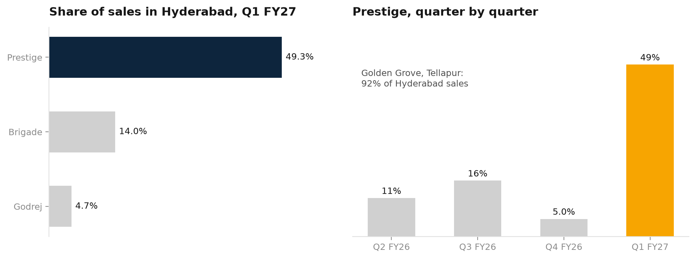
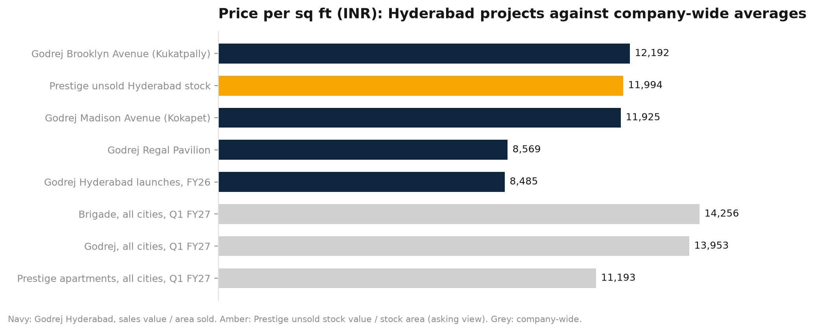

# Hyderabad Residential Market Benchmark

What Prestige, Godrej and Brigade say, in their own investor documents, about selling and
building homes in Hyderabad through June 2026. Sales by city, price per sq ft, launch pipeline,
land added, and a cash-flow and cost-to-complete model for one live project.

It covers three listed developers, not the whole market. RERA registrations and listing prices
are out of scope (see below).

## What it finds

| | |
|---|---|
| Prestige's Hyderabad share of sales | 5.0% in Q4 FY26, 49.3% in Q1 FY27. One Tellapur launch, Golden Grove, is 92% of that quarter's Hyderabad sales |
| Brigade, Godrej share of sales, Q1 FY27 | 14% and 4.7% |
| Godrej Regal Pavilion, price sold at | ₹8,569 per sq ft, 39% below Godrej's ₹13,953 company average |
| Godrej Madison Avenue (Kokapet) | ₹11,925 per sq ft |
| Godrej's own estimates, unlaunched sites | ₹16,339 per sq ft at Neopolis (Kokapet), ₹13,149 at Kukatpally |
| Regal Pavilion cash view, base case | ₹2,832 cr collections against ₹1,359 cr cost still to spend (2.1x); no funding need in any of three scenarios |





The full write-up is [output/Hyderabad_Residential_Benchmark.pdf](output/Hyderabad_Residential_Benchmark.pdf).
The workbook, [output/Hyderabad_Residential_Benchmark.xlsx](output/Hyderabad_Residential_Benchmark.xlsx),
holds live formulas: change a yellow cell on the `CashFlow` sheet and everything recalculates.

## How it is built

1. `src/extract.py` holds 103 figures typed from the filings. Each names a label that must sit
   on the same PDF page as the number; the script finds the page and stops if it cannot, so a
   mistyped figure fails loudly. Output: `data/hyderabad_developer_metrics.csv`.
2. `src/build_workbook.py` writes the workbook. Every calculated cell pulls its inputs from the
   sourced table with `SUMIFS`, so it traces to a filing page.
3. `src/model.py` is an independent Python version of the cash-flow sheet.
4. `src/charts.py` and `src/build_report.py` make the charts and the PDF from the same facts.

```
pip install -r requirements.txt
python3 src/extract.py          # needs the PDFs in data/raw/src (see data/SOURCES.md)
python3 src/build_workbook.py
python3 src/charts.py
python3 src/build_report.py
python3 tests/test_benchmark.py
```

## Checks

`python3 tests/test_benchmark.py` confirms:
- the sourced table has 103 rows, each with a page number;
- Prestige's six city sales sum to its printed total (₹65,793 mn) and Godrej's six city bookings sum to ₹8,651 cr;
- the workbook, recalculated in LibreOffice, gives the same cash-flow results as `src/model.py` for all three scenarios (skipped if `soffice` is not installed);
- cash is conserved in every quarter of the schedule.

## Where the numbers are soft

- **Cost inputs for the cash-flow model.** Godrej does not publish project costs. The cost share of sale value (63.7%) and the share already incurred (39.7%) are Brigade's ongoing-project ratios, used as a benchmark. Brigade is mostly Bengaluru. The remaining assumptions (price change, quarters to completion, discount rate, slow-case sales pace) are illustrative and are marked as such in the workbook.
- **Not in the model:** land cost, financing, GST, approvals, overheads. The 2.1x coverage is therefore a ceiling on comfort, not a forecast.
- **Shares printed only as percentages:** Brigade Q1 FY27 (read from a chart), Prestige Q2 and Q3 FY26. The rupee figures beside them are derived.
- **Prestige value per sq ft** uses gross development value over total developable area, which includes unsold space, so it reads low next to Godrej's saleable-area figures. The two are not compared.
- **Micro-markets** are only those the filings name (Tellapur, Kokapet, Kukatpally, Kompally and others). Godrej does not name one for Regal Pavilion, so none is assigned.

## What is not here

RERA registrations and listing prices. Telangana RERA's project search sits behind a CAPTCHA, and this
project does not use scraped or estimated listings.

## Layout

```
data/hyderabad_developer_metrics.csv   sourced figures, with file and page
data/SOURCES.md                        documents used and where to get them
src/                                   extract, workbook, model, charts, report
tests/test_benchmark.py
output/                                workbook, PDF, charts
```

## Licence

MIT. The developers' filings that the figures come from remain the companies' own publications.
